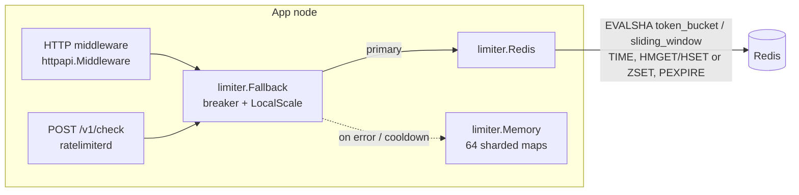

# go-rate-limiter

[](https://github.com/anirudhpundhir/go-rate-limiter/actions/workflows/ci.yml)

A distributed rate limiter in Go: **token bucket** and **exact sliding window**, backed by Redis through **atomic Lua scripts** that use the Redis clock. It has an **in-memory fallback** for Redis outages, `net/http` middleware, and a JSON check API for non-Go services.

- **Correct under concurrency**: one Lua script per decision. A test runs 32 goroutines against one key on real Redis and asserts *exactly* `Limit` admissions.
- **Skew-proof**: `now` is read from `redis.call('TIME')`, so app-node clock skew can't widen limits.
- **One behaviour, three backends**: a single conformance suite (boundaries, `Retry-After`, randomized invariants, concurrency) runs on memory, miniredis and real Redis.
- **Degrades gracefully**: `Fallback` switches to local limiting with a cooldown breaker, and `LocalScale` approximates the global limit per replica.

## Architecture



```mermaid
sequenceDiagram
    participant C as Caller
    participant L as limiter.Redis
    participant R as Redis (Lua, atomic)
    C->>L: Allow(key, rule, n)
    L->>R: EVALSHA sha KEYS[rl:sw:{key}] limit window n
    R->>R: now = TIME; ZREMRANGEBYSCORE < now-window; ZCARD
    alt count+n <= limit
        R->>R: ZADD n members; PEXPIRE window
        R-->>L: {1, remaining, 0}
    else
        R-->>L: {0, remaining, retry_us}
    end
    L-->>C: Decision{Allowed, Remaining, RetryAfter, Source}
```

Layout:

```
limiter/            Limiter interface, Memory, Redis (Lua), Fallback; conformance + benchmarks
httpapi/            middleware (RateLimit-* headers, 429 + Retry-After), check API, policy parsing
cmd/ratelimiterd/   server: flags, Redis+fallback wiring, graceful shutdown
docs/DESIGN.md      ADRs: algorithms, Lua atomicity, clock, fallback, API
```

## Quick start

```bash
redis-server --port 6379 &                     # any Redis >= 5
make build
./bin/ratelimiterd -redis localhost:6379 \
  -policy api=token_bucket:100:1m -policy login=sliding_window:2:1m
```

```console
$ curl -s -XPOST localhost:8080/v1/check -d '{"policy":"login","key":"alice"}'
{"allowed":true,"limit":2,"remaining":1,"retry_after_ms":0,"source":"redis"}
$ curl -s -XPOST localhost:8080/v1/check -d '{"policy":"login","key":"alice"}'
{"allowed":true,"limit":2,"remaining":0,"retry_after_ms":0,"source":"redis"}
$ curl -s -XPOST localhost:8080/v1/check -d '{"policy":"login","key":"alice"}'
{"allowed":false,"limit":2,"remaining":0,"retry_after_ms":59987,"source":"redis"}
# kill Redis -> answered by the local fallback
$ curl -s -XPOST localhost:8080/v1/check -d '{"policy":"login","key":"alice"}'
{"allowed":true,"limit":2,"remaining":1,"retry_after_ms":0,"source":"memory"}
```

(That's real output from a local run. Note that the fallback starts from empty state; see ADR-004.)

### As a library

```go
rc := redis.NewClient(&redis.Options{Addr: "localhost:6379", ReadTimeout: 50 * time.Millisecond})
lim := limiter.NewFallback(limiter.NewRedis(rc), limiter.NewMemory(nil))
lim.LocalScale = 1.0 / 3 // 3 replicas

mux.Handle("/v1/charges", httpapi.Middleware(httpapi.MiddlewareConfig{
    Limiter: lim,
    Rule:    limiter.Rule{Algorithm: limiter.TokenBucket, Limit: 100, Window: time.Second},
    Key:     httpapi.ByHeader("Authorization"),
})(chargesHandler))
```

## Testing

```bash
make test                         # memory + miniredis, -race
make test-redis REDIS_ADDR=...    # + conformance against real Redis (CI does this)
```

What's covered: exact token/window boundaries and `Retry-After` values; rejection consumes nothing; `n > Limit` → never; randomized property tests over 2000 random arrivals; **concurrent exact admission** (32×50 calls, `Limit=500` ⇒ exactly 500) on every backend; script reload after `SCRIPT FLUSH`; Redis down → error → fallback → recovery; middleware fail-open/closed; API validation. Coverage: `limiter` 91.3%, `httpapi` 96.5%.

## Benchmarks

Measured with `make bench` on the build box: **8 vCPU Intel Xeon (virtualized), 15 GiB RAM, Linux, Go 1.25.0, Redis 8.0.2 on the same host over loopback** (no persistence). `RunParallel` with GOMAXPROCS=8. These are single-box numbers, not a capacity claim. Real deployments are dominated by network RTT.

| Benchmark | ns/op | allocs/op |
|---|---:|---:|
| Memory token bucket, 1 hot key | 270 | 0 |
| Memory token bucket, 10k keys | 42.7 | 0 |
| Memory sliding window, 1 hot key | 263 | 0 |
| Memory sliding window, 10k keys | 65.4 | 0 |
| Redis token bucket, 1 key | 11,055 | 16 |
| Redis token bucket, 10k keys | 11,142 | 16 |
| Redis sliding window, 1 key | 13,029 | 16 |
| Redis sliding window, 10k keys | 12,148 | 16 |

So, about 90k decisions/s against one local Redis. The hot-key cost in memory is mutex contention on one shard. The sliding-window benchmarks use `Limit=100/1ms` to bound the log size, so they include both admits and rejects.

## License

MIT
